<!-- README.md is generated from README.Rmd. Please edit that file -->

# GEGVIC

<!-- badges: start -->
<!-- badges: end -->

GEGVIC is a workflow to analyse **G**ene **E**xpression, **G**enomic
**V**ariations and **I**mmune cell **C**omposition of tumour samples
using Next Generation Sequencing data. This is a common need in the majority of the cancer research labs, but often the wide variety of tools available to perform each task can make the process confusing and difficult, especially for inexperienced bioinformatic users.

Here we present an easy-to-use tool that requires a very few input files, provides a good flexibility, and produces appealing outputs when comparing a group of samples for (i) *differential gene expression*,
(ii) *genomic variations* and (iii) *immune cell composition*.

<figure>
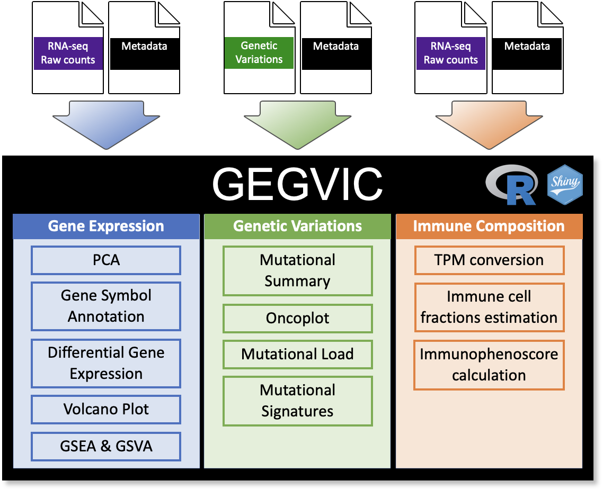
<figcaption aria-hidden="true">GEGVIC outline</figcaption>
</figure>

## Installation

**NOTE!!: GEGVIC does not run properly under R version 4.2 since there were problems with some third package dependencies. Use either versions** $\le$ **4.1.3 or** $\ge$ **4.3.0.**

You can install the development version of `GEGVIC` from
[GitHub](https://github.com/oriolarques/GEGVIC) with:

``` r
# install.packages("devtools")
devtools::install_github("oriolarques/GEGVIC")
```

Since this package requires many dependencies, it is **strongly recommended** to
execute the following code before using it for the first time to properly prepare your environment.

``` r
# CRAN packages 
if(!require(shiny)) install.packages("shiny")
if(!require(dplyr)) install.packages("dplyr")
if(!require(tibble)) install.packages("tibble")
if(!require(tidyr)) install.packages("tidyr")
if(!require(ggplot2)) install.packages("ggplot2")
if(!require(ggrepel)) install.packages("ggrepel")
if(!require(rlang)) install.packages("rlang")
if(!require(ggplotify)) install.packages("ggplotify")
if(!require(ggpubr)) install.packages("ggpubr")
if(!require(patchwork)) install.packages("patchwork")
if(!require(gridExtra)) install.packages("gridExtra")
if(!require(pheatmap)) install.packages("pheatmap")
if(!require(devtools)) install.packages("devtools")
if(!require(remotes)) install.packages("remotes")
if(!require(DT)) install.packages("DT")
if(!require(shinyFiles)) install.packages("shinyFiles")
if(!require(shinythemes)) install.packages("shinythemes")
if(!require(tm)) install.packages("tm")
if(!require(rmarkdown)) install.packages("rmarkdown")

# Bioconductor packages
if (!requireNamespace("BiocManager", quietly = TRUE)) install.packages("BiocManager")
if(!require(DESeq2)) BiocManager::install("DESeq2")
if(!require(apeglm)) BiocManager::install("apeglm")
if(!require(maftools)) BiocManager::install("maftools")
if(!require(clusterProfiler)) BiocManager::install("clusterProfiler")
if(!require(GSEAmining)) BiocManager::install("GSEAmining")
if(!require(GSEABase)) BiocManager::install("GSEABase")
if(!require(GSVA)) BiocManager::install("GSVA")
if(!require(SummarizedExperiment)) BiocManager::install("SummarizedExperiment")
if(!require(BSgenome)) BiocManager::install("BSgenome")
if(!require(BSgenome.Hsapiens.UCSC.hg19)) BiocManager::install("BSgenome.Hsapiens.UCSC.hg19")
if(!require(BSgenome.Hsapiens.UCSC.hg38)) BiocManager::install("BSgenome.Hsapiens.UCSC.hg38")
if(!require(BSgenome.Mmusculus.UCSC.mm10)) BiocManager::install("BSgenome.Mmusculus.UCSC.mm10")
if(!require(BSgenome.Mmusculus.UCSC.mm39)) BiocManager::install("BSgenome.Mmusculus.UCSC.mm39")
if(!require(DO.db)) BiocManager::install("DO.db")
if(!require(GO.db)) BiocManager::install("GO.db")

# Github packages
remotes::install_github("icbi-lab/immunedeconv")
devtools::install_github('raerose01/deconstructSigs')
devtools::install_github("oriolarques/GEGVIC")
```

## Input data format

GEGVIC requires three main input data:

1.  **RNA-sequencing raw counts (Counts)**: Table containing raw (un-normalized) gene
    counts as rows and samples as columns. The first column must contain
    gene identifiers that can be either *NCBI ID*, *ENSEMBL gene ID* or
    *HGNC ID* and its column name **MUST** be adequately named as
    either:

- **entrezgene_id**

- **ensembl_gene_id**

- **hgnc_symbol**

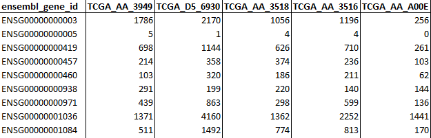

2.  **Genomic variations data (Muts)**: Table containing short variant
    calls. Necessary columns **MUST** have the following names
    (following the [MAF
    format](https://docs.gdc.cancer.gov/Data/File_Formats/MAF_Format/)):
    - Hugo_Symbol: Gene symbol from HGNC.
    - Chromosome: Affected chromosome.
    - Start_Position: Mutation start coordinate.
    - End_Position: Mutation end coordinate.
    - Reference_Allele: The plus strand reference allele at this
      position. Includes the deleted sequence for a deletion or “-” for
      an insertion.
    - Tumor_Seq_Allele2: Tumor sequencing discovery allele.
    - Variant_Classification: Translational effect of variant allele.
      Can be one of the following: Frame_Shift_Del, Frame_Shift_Ins,
      In_Frame_Del, In_Frame_Ins, Missense_Mutation, Nonsense_Mutation,
      Silent, Splice_Site, Translation_Start_Site, Nonstop_Mutation,
      RNA, Targeted_Region.
    - Variant_Type: Type of mutation. Can be: ‘SNP’ (Single nucleotide
      polymorphism), ‘DNP’ (Double nucleotide polymorphism), ‘INS’
      (Insertion), ‘DEL’ (Deletion).
    - Tumor_Sample_Barcode: Sample name.

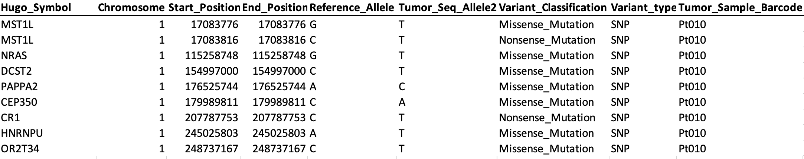

3.  **Samples metadata**: Table that contains additional information to
    the samples to create groups such as response to a therapy. The
    first column MUST be named **Samples** and contain the same
    nomenclature for each sample as in the *RNA-sequencing raw counts*
    and *Genomic variations data tables*.

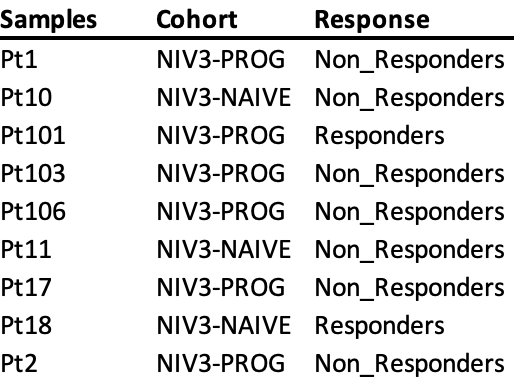

## Example of usage

Here, we will explore the workflow, how to use each function and the outputs they generate. Users can use their own data (in the appropriate format, as noted above) by loading it into the R workspace, or they can use the provided pre-loaded input data obtained from a random subset of 20 tumor samples from the TCGA-COADREAD.

*Notes:*

- *All the functions names have a prefix that indicate to which module
  they belong.*
- *For further information about specific function argument, install the
  GEGVIC package and use the help function or visit the description page
  for the corresponding function in the GitHub repository under the
  ‘R/’ section.*

``` r
# load the package
library(GEGVIC)
```

### 1. Gene Expression module (GE)

This module uses the functionalities provided by the `DESeq2`
[package](https://bioconductor.org/packages/release/bioc/html/DESeq2.html). Note that the DESeq2 model internally corrects for library size, so transformed or normalized values should not be used as input. 

#### 1.1. Principal Component Analysis (PCA)

Using the `ge_pca()` function we can perform a PCA to evaluate how samples and groups are related to each other. To do this, we specify the raw counts file (sample_counts), the gene identifiers used in the counts file (e.g., ‘ensembl_gene_id’), the metadata file (sample_metadata) and the name of the column (**unquoted**) containing the groups of interest as the ‘response’ argument. The ‘design’ should be a term describing how the counts for each sample depend on the variable specified from the metadata, colored according to user-defined colors. The function returns a plot.

``` r
ge_pca(counts = sample_counts,
       genes_id = 'ensembl_gene_id',
       metadata = sample_metadata,
       response = MSI_status,
       design = 'MSI_status',
       colors = c('orange', 'black'))
```

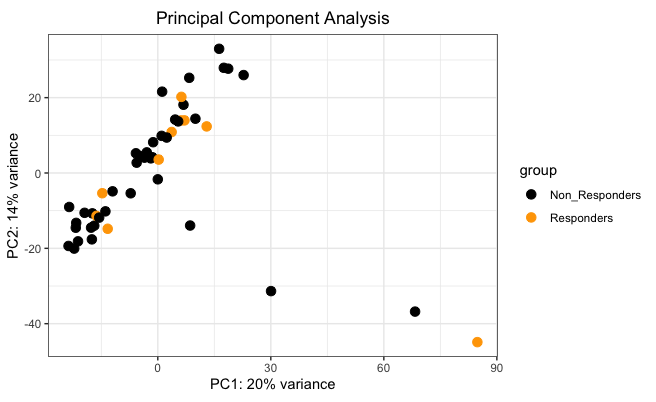

#### 1.2. Differential gene expression (DGE) analysis

Then, we can compute differential gene expressionDGE analysis between groups of interest using the `ge_diff_exp()` function and store the results in thean object (*results.dds*).

Here, we need to define new parameters such as (i) the ‘ref_level’, which consists of specifying the variable selected from the metadata (i.e., the one used in the ‘response’ argument in the `ge_pca` function) and the group to be used as the reference level (i.e., the group to which the others will be compared); and (ii) the log2 fold change shrinkage method to apply (or not). The apeglm is the current default estimator in DESeq2, but more detailed information about all shrinkage methods can be found in this DESeq2 Bioconductor [vignette](https://bioconductor.org/packages/release/bioc/vignettes/DESeq2/inst/doc/DESeq2.html#quick-start.html).

**In the case there are multiple levels of comparison the results object will be
in a form of a list.**

``` r
results.dds <- ge_diff_exp(counts = sample_counts,
                           genes_id = 'ensembl_gene_id',
                           metadata = sample_metadata,
                           design = 'MSI_status',
                           ref_level = c('MSI_status', 'MSS'),
                           shrink = 'apeglm')
```

#### 1.3. Gene annotation

If the provided gene identifiers are not in the form of HGNC symbols, we can use the `ge_annot()`
function to perform the appropriate conversion and store the results in a new object (*annot.res*). To do this, we need to specify a query from the `biomart`
[package](https://bioconductor.org/packages/release/bioc/html/biomaRt.html)
with the following attributes: *ensembl_gene_id*, *hgnc_symbol*, *entrezgene_id*, *transcript_length*, *refseq_mrna*. The following databases are already available in GEGVIC:

- Genome Reference Consortium Human Build 37: *ensembl_biomart_GRCh37*.

- Genome Reference Consortium Human Build 38:
  *ensembl_biomart_GRCh38_p13*.

- Genome Reference Consortium Mouse Build 38 (mm10):
  *ensembl_biomart_GRCm38_p6*.

- Genome Reference Consortium Mouse Build 39 (mm39):
  *ensembl_biomart_GRCm39*.

``` r
annot.res <- ge_annot(results_dds = results.dds,
                      genes_id = 'ensembl_gene_id',
                      biomart = ensembl_biomart_GRCh38_p13)
```

#### 1.4. Volcano plot

To visualize the DGE results, the `ge_volcano()` function generates volcano plots for each of the comparison groups established in the analysis. The function allows the user to define the fold change and adjusted p-value thresholds. The top ten most significantly up- and down-regulated genes are highlighted and labeled in the plot.

``` r
ge_volcano(annot_res = annot.res, 
           fold_change = 2, 
           p.adj = 0.05)
```

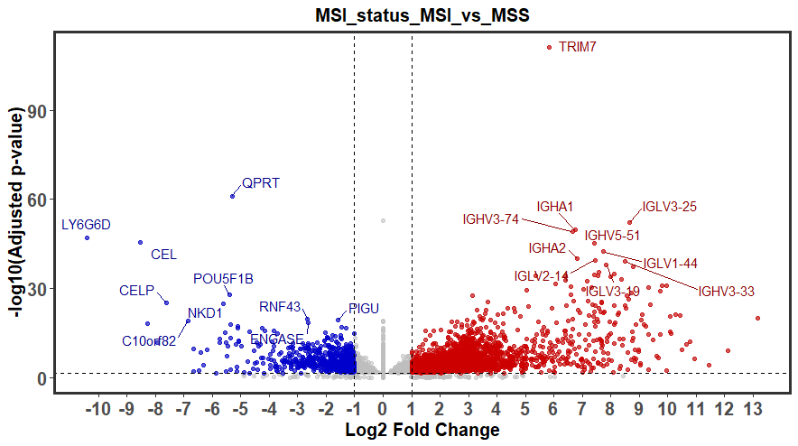

#### 1.5. Functional Enrichment Analysis

To perform the functional enrichment analysis, GEGVIC provides two complementary methods: (a) Gene Set Enrichment Analysis (GSEA), which determines whether a specific pre-defined gene set is significantly enriched in one of the comparison groups of interest (*supervised* approach); and (b) Gene Set Variation Analysis (GSVA), which estimates a sample-specific enrichment score for each gene set, allowing to evaluate the degree of clustering between samples (*unsupervised* approach). 

*1.5a. GSEA: Gene Set Enrichment Analysis*

The `ge_gsea()` function allows to perform GSEA using the functionalities of the `clusterProfiler`
[package](https://bioconductor.org/packages/release/bioc/html/clusterProfiler.html)
with the option of modifying the adjusted p-value threshold. To use this function, we must provide the collection of gene sets of interest to be evaluated, in a form of a gmt file. These can be downloaded from the Molecular Signatures Database, with a previous registration [MSigDB](https://www.gsea-msigdb.org/gsea/login.jsp) or created by the user following the appropriate guidelines. When working with mouse data, gene symbols are automatically transformed to human orthologs, so that the same gene sets from MSigDB can be used. For this specific example, the Reactome gene sets were downloaded (**c2.cp.reactome.v7.5.1.symbols.gmt** file).

The function generates two plots, one dendrogram and one wordcloud with the most enriched name terms in each cluster in the dendrogram. The resulting top 20 regulated gene sets are shown in a bubble plot where Normalized Enrichment Score (NES) is shown. The size of the bubbles are determined by the percentage of genes in the gene set that belong to the leading edge (core). Then, the same gene sets are grouped by similarity and plotted using the `GSEAmining`
[package](https://bioconductor.org/packages/release/bioc/html/GSEAmining.html). Two more plots are generated, first a cluster of gene sets and, per each cluster, a wordcloud of biological terms enriched in each case and the top 3 genes in the leading edge of the different gene sets present in that cluster.

To access to the results table we can call the object result as `gsea.res$table_name@result` or
`as.data.frame(gsea.res)`.

``` r
gsea.res <- ge_gsea(annot_res = annot.res,
                    gmt = 'inst/extdata/c2.cp.reactome.v7.5.1.symbols.gmt',
                    gsea_pvalue = 0.2)
```

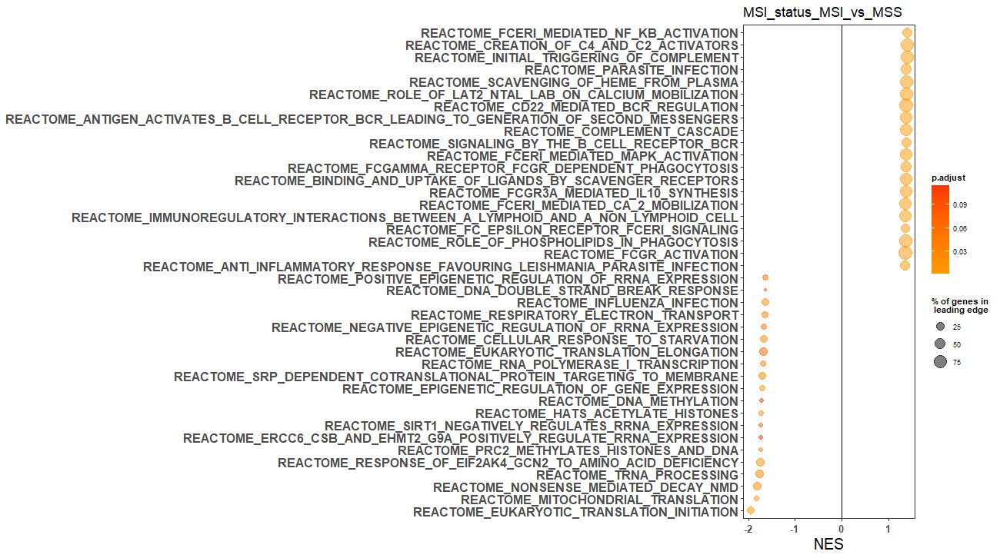

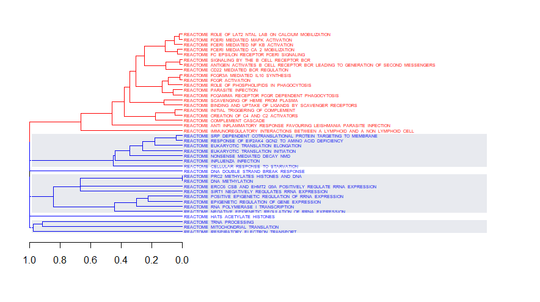

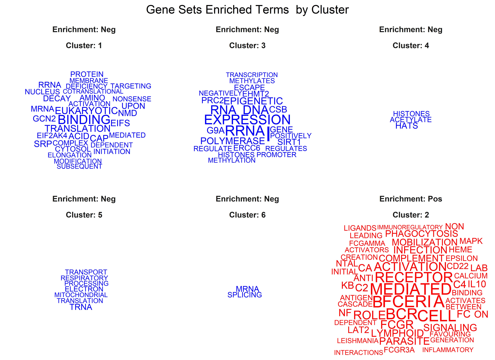

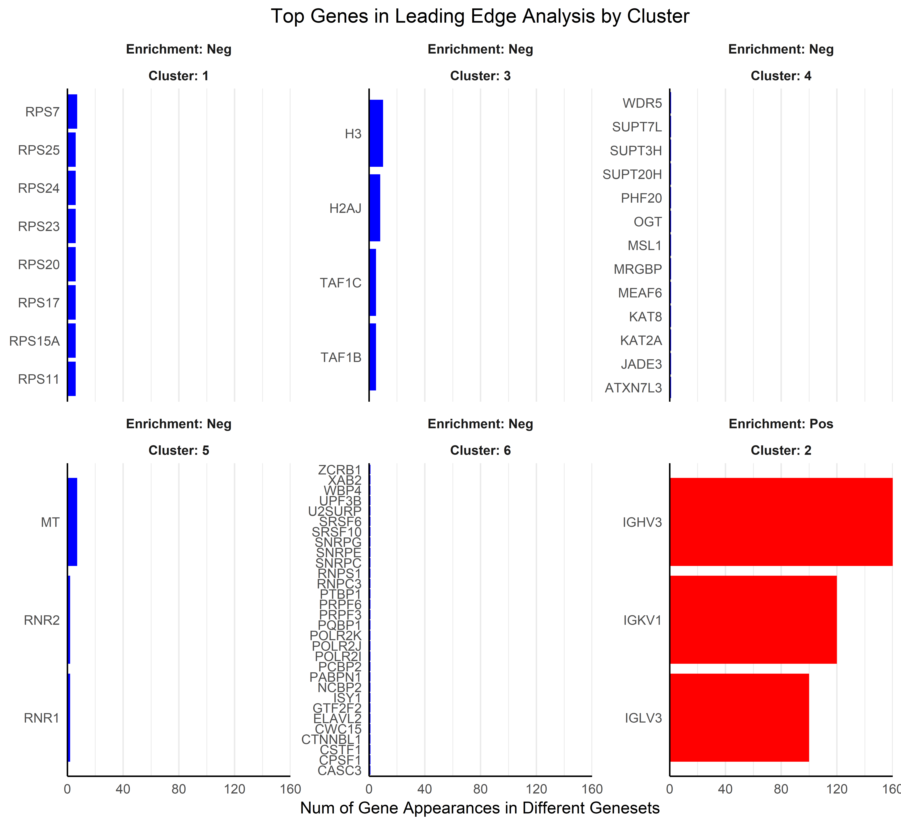

*1.5b. GSVA: Gene Set Variation Analysis*

The `ge_single()` function allows to perform a GSVA to cluster samples in an unsupervised manner using the
`GSVA`
[package](https://bioconductor.org/packages/release/bioc/html/GSVA.html).
To do this, we must define the method and also specify the gene set collection of interest. By default, the HALLMARK collection from the MSigDB is used if the location of a another .gmt file is not provided in the ‘gsva_gmt’ argument.

The results are displayed as a heatmap. We can define the color of the sample groups and whether or not to plot gene set names and/or sample names.

``` r
gsva.res <- ge_single(counts = sample_counts,
                      metadata = sample_metadata,
                      genes_id = 'ensembl_gene_id',
                      response = MSI_status,
                      design = 'MSI_status',
                      biomart = ensembl_biomart_GRCh38_p13,
                      gsva_gmt = 'hallmark',
                      method = 'gsva',
                      kcdf = 'Gaussian',
                      colors = c('orange', 'black'),
                      row.names = TRUE,
                      col.names = TRUE)
```


### 2. Immune cell Composition module (IC)

This module uses functionalities from the `immunedeconv`
[package](https://github.com/icbi-lab/immunedeconv).

#### 2.1 Transform raw counts to TPM

To predict the immune composition of the tumor microenvironment from RNA sequencing data, we first need to transform the raw counts to TPM (Transcript Per kilobase Million), as required by most of the methods in the immunedeconv package. The ic_raw_to_tpm()function takes the same input as the GE_module. We also need to specify the type of gene identifier and the biomaRt database. The results should be stored as a new object (i.e.: **tmp**).

``` r
tpm <- ic_raw_to_tpm(counts = sample_counts,
                     genes_id = 'ensembl_gene_id',
                     biomart = ensembl_biomart_GRCh38_p13)
```

#### 2.2. Predict immune cell composition

The object containing the TPM reads is used as the input to the `ic_deconv()` function, which estimates the immune cell composition of the samples. All of the following methods (included in the `immunedeconv` package) can be used: QUANTISEQ, TIMER, MCP_COUNTER, XCELL, EPIC and CIBERSORT.

*Note: To use the CIBERSORT, the user must first register on the CIBERSORT web site (https://cibersort.stanford.edu), obtain a license and download the source code in the form of two files CIBERSORT.R and LM22.txt. Then, the user must specify the path to the location of these files in the ‘cibersort’ argument, or set it to NULL to not include this tool in the analysis.*

The indications argument must be a character vector of cancer type codes for each sample in the tpm matrix. Supported indications can be checked using immunedeconv::timer_available_cancers. Results should be stored in a new object
(i.e.: **ic.pred**). To access to the results table we can call the result object as `ic_pred.df <- as.data.frame(ic_pred)`

``` r
ic.pred <- ic_deconv(gene_expression = tpm,
                     indications = rep('coad', ncol(tpm)),
                     cibersort = 'cibersort/', # Set to NULL to not use this option
                     tumor = TRUE,
                     rmgenes = NULL,
                     scale_mrna = TRUE,
                     expected_cell_types = NULL)
```

#### 2.3. Plot cell predictions (summarized results)

To facilitate a global interpretation of the immune deconvolution analysis, GEGVIC proposes the `ic_plot_comp_samples()` function to integrate, visualize and compare seven major immune subpopulations that are commonly detected by all the algorithms included in the immunedeconv package. These are B-Cells, Macrophages, mDendritic cells, Neutrophils, NK cells, T-CD4+ and T-CD8+ cells.

The function returns a panel of boxplots comparing each immune category between sample groups per method. To do this, the name of the column where the grouping variable is located must be written **WITHOUT** quotes in the ‘response’ argument. We can select which method to use to compare the means (i.e., ‘t.test’ and ‘wilcox.test’ for two groups or ‘anova’ and ‘kruskal.test’ for more groups). The ‘p_label’ argument allows you to choose how the significance is displayed, being either ‘p.signif’ (shows the significance levels) or ‘p.format’ (shows the formatted p-value). The function also allows you to change the colors of the groups and decide whether to add points to the plot.

``` r
ic_plot_comp_samples(df = ic.pred,
                     metadata = sample_metadata,
                     response = MSI_status,
                     compare = 'wilcox.test',
                     p_label = 'p.format',
                     colors = c('orange', 'black'),
                     points = FALSE)
```

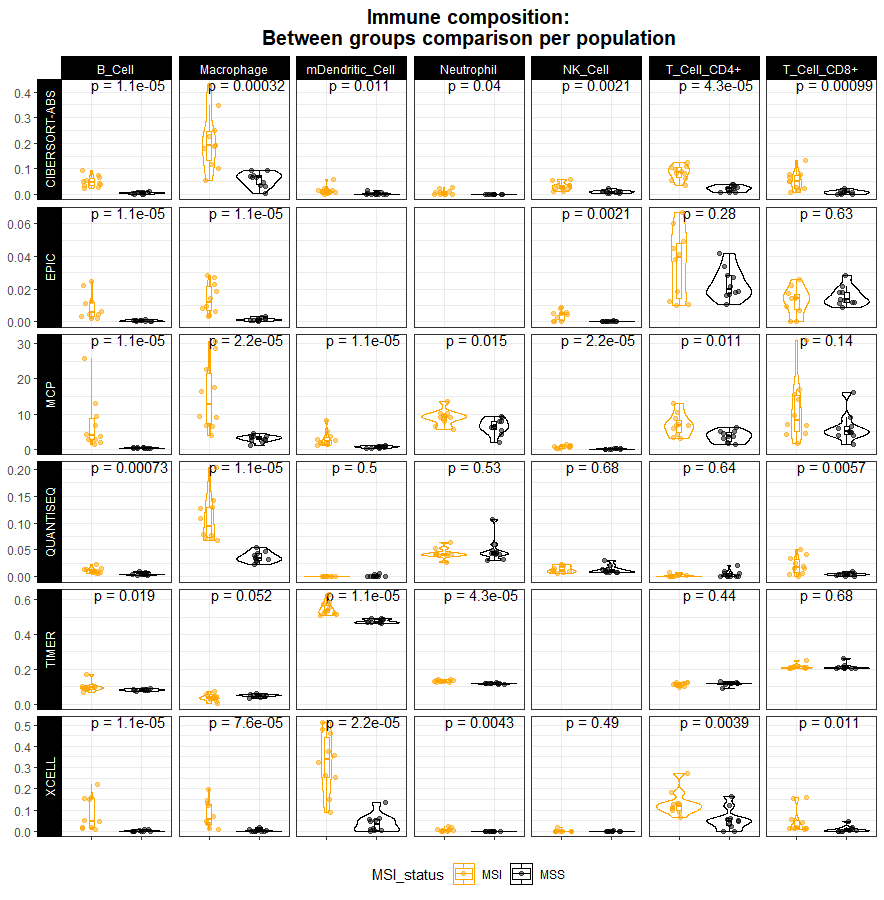

Similarly, the `ic_plot_comp_celltypes()` function is able to plot the comparison of each immune cell fraction within each sample from the predictions made by CIBERSORT, EPIC and QUANTISEQ.

``` r
ic_plot_comp_celltypes(df = ic.pred,
                       metadata = sample_metadata,
                       response = MSI_status,
                       col.names = TRUE)
```


#### 2.4. Calculate Immunophenogram and Immunophenoscores

The last function in this module, `ic_score`, uses TPM expression values to calculate immunophenoscores (IPS) and plot immunophenogram and for each sample and study group. It gives an overall picture of the status of Major Histocompatibility molecules (MHC), check-points/immunomodulators (CP), effector cells (EC) and suppressor cells (SC) in each sample and allow comparison between samples. For further interpretation please visit https://tcia.at/tools/toolsMain.

To access to the results table we can call the result object as `ips.df <- as.data.frame(ips)`

**Note: Immunophenograms are generated in a pdf file containing the
results for each sample in a single page. The output file, named
`immunophenogram_report.pdf`, will be stored in the working
directory.**

``` r
ips <- ic_score(tpm = tpm,
                metadata = sample_metadata,
                response = MSI_status,
                compare = 'wilcox.test',
                p_label = 'p.format',
                colors = c('orange', 'black'))
```

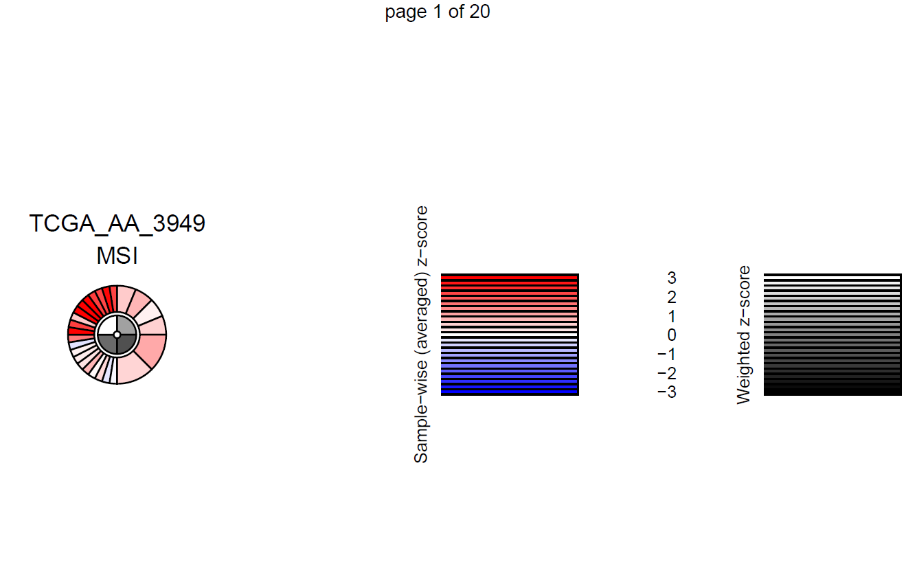

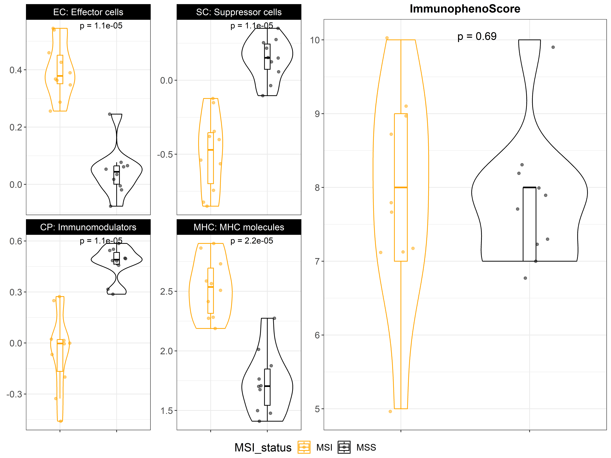

### 3. Genomic Variations module (GV)

This module uses functionalities from the `maftools` [package](https://bioconductor.org/packages/release/bioc/html/maftools.html) and the `deconstructSigs` [package](https://github.com/raerose01/deconstructSigs). The input files are the standard maf file obtained from any DNA variant caller (*sample_mutations*, in this example) and the same sample metadata file used in the previous modules.

#### 3.1. Mutational summary

The `gv_mut_summary()` function generates first a group of plots summarizing the type of mutations present in the dataset, and second an oncoplot highlighting the most common mutations identified in each group of interest.

Users **MUST** specify the **unquoted name** of the column from the metadata containing the groups of interest in the ‘response’ argument. Additionally, parameters that define the number and which genes will appear in the oncoplot, the colors of the sample groups, and whether the names of the samples will appear in the plot can be modified.

``` r
gv_mut_summary(muts = sample_mutations,
               metadata = sample_metadata,
               response = MSI_status,
               top_genes = 10,
               specific_genes = NULL,
               col.names = FALSE,
               colors = c('orange', 'black'))
```

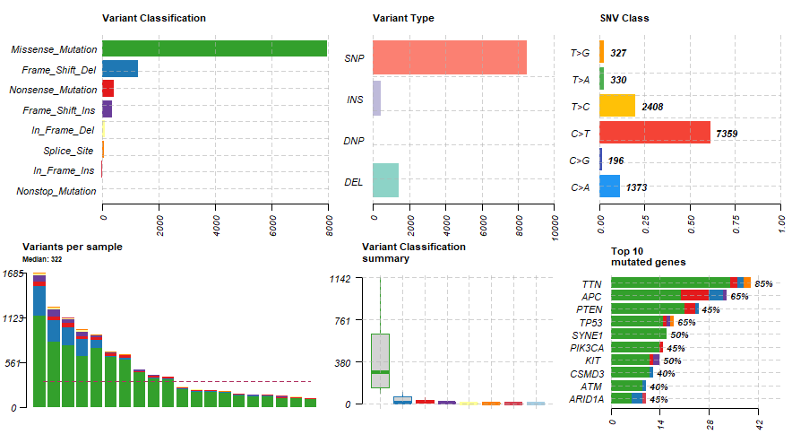

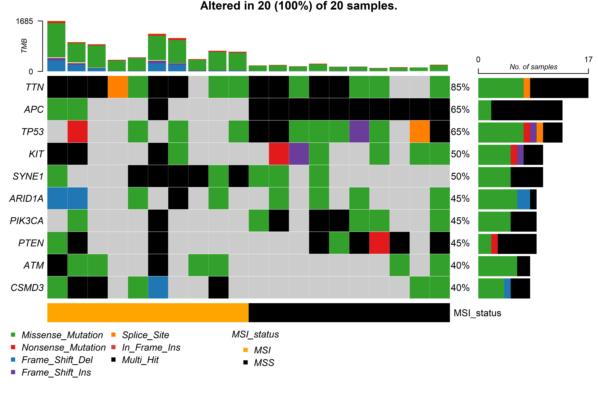

#### 3.2. Mutational load

The `gv_mut_load()` function calculates the total number of mutations per sample by using the same input files as the previous function. The arguments ‘compare’ and ‘p_label’ allow you to decide which method to use to compare the means and how to display the significance. As usual, the function also allows you to change the color of the groups.

``` r
mut.load <- gv_mut_load(muts = sample_mutations,
                        metadata = sample_metadata,
                        response = MSI_status,
                        compare = 'wilcox.test',
                        p_label = 'p.format',
                        colors = c('orange', 'black'))
```

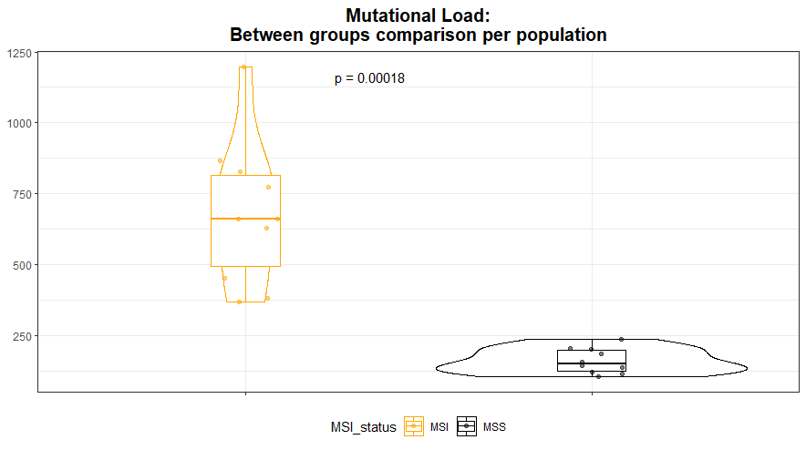

#### 3.3. Mutational signatures

The last function of the module, `gv_mut_signatures()` allows to predict the weight of mutational signatures contributing to an individual tumor sample. In addition to the inputs described above, we must specify the version of the genome to work with. The ‘gbuild’ argument should be one of the following:

- ‘BSgenome.Hsapiens.UCSC.hg19’

- ‘BSgenome.Hsapiens.UCSC.hg38’

- ‘BSgenome.Mmusculus.UCSC.mm10’

- ‘BSgenome.Mmusculus.UCSC.mm39’

The mutation signature matrices containing the frequencies of all nucleotide changes per signature must also be provided. GEGVIC already incorporates the matrices from 
[COSMIC](https://cancer.sanger.ac.uk/signatures/downloads/) for single
and double base substitutions.

To choose one, the user has to indicate ’COSMIC_v{XX}\_{YY}BS_GRCh{ZZ}’
(i.e. ‘COSMIC_v2_SBS_GRCh37’) in the mut_sigs argument:

- **XX** is the version, which can be v2 or v3.2.

- **YY** indicates whether the mutations are single (S) or double (D) base substitutions.

- **ZZ** is for the genome assembly, either GRCh37 or GRCh38 for human data and mm9 or mm10 for mouse data.

The function produces two plots. The first one is a barplot showing the weight of the top four mutational signatures per sample and group. Since the results may be difficult to interpret depending on how many samples or signatures are present in the analysis, a second plot is generated. This is a heatmap that shows all samples as columns and signatures as rows, and the weight of each signature determines the intensity of the color. We believe that although the first plot is more common in the literature, the second plot can be helpful, especially when many mutational signatures are present in many samples.

``` r
mut.sigs <- gv_mut_signatures(muts = sample_mutations,
                              metadata = sample_metadata,
                              response = MSI_status,
                              gbuild = 'BSgenome.Hsapiens.UCSC.hg38',
                              mut_sigs = 'COSMIC_v2_SBS_GRCh38',
                              tri.counts.method = 'default',
                              colors = c('orange', 'black'),
                              col.names = TRUE)
```

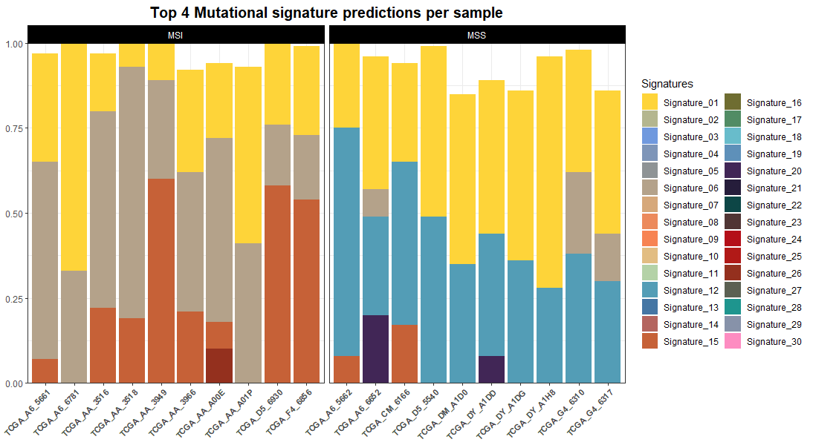

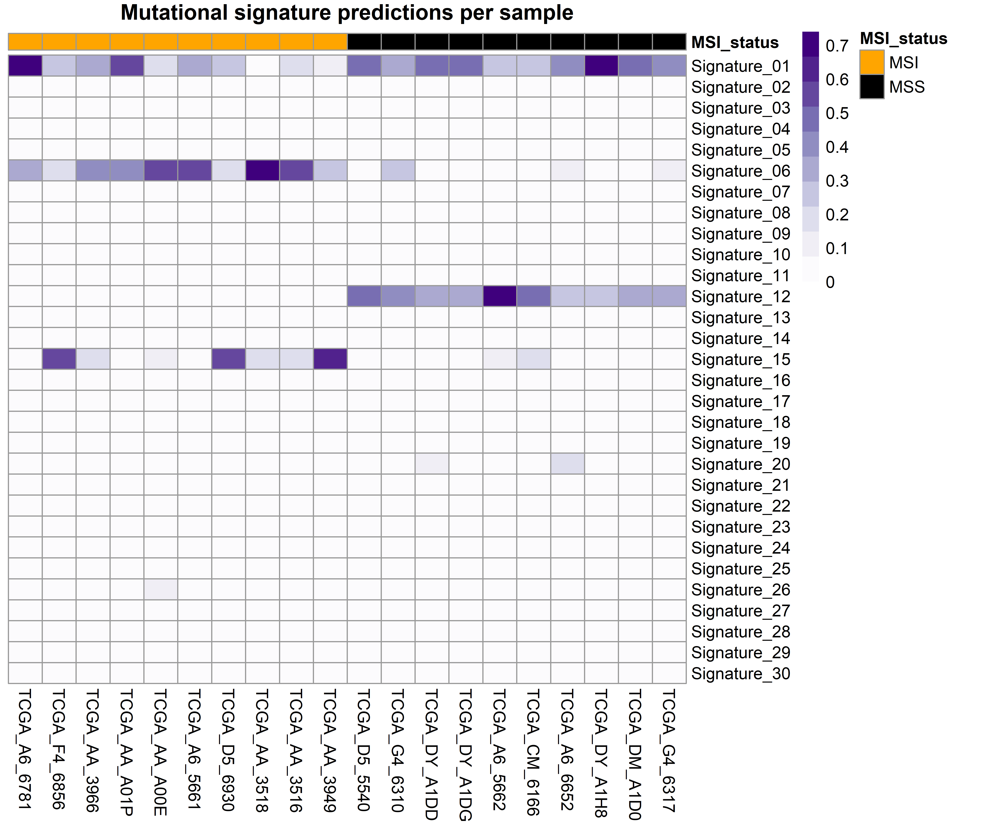

## Additional Features

### Execution by modules

GEGVIC offers the possibility to execute all the functions of a specific module at once, using a single function with all the parameters described above. To access the result tables, the output must be stored in a new object.

``` r
# Gene Expression Module (GE)
tables_module_ge <- module_ge(counts = sample_counts,
                              genes_id = 'ensembl_gene_id',
                              metadata = sample_metadata,
                              response = MSI_status,
                              design = 'MSI_status',
                              colors = c('orange', 'black'),
                              ref_level = c('MSI_status', 'MSS'),
                              shrink = 'apeglm',
                              biomart = ensembl_biomart_GRCh38_p13,
                              fold_change = 2,
                              p.adj = 0.05,
                              gmt = 'inst/extdata/c2.cp.reactome.v7.5.1.symbols.gmt',
                              gsea_pvalue = 0.2,
                              gsva_gmt = 'hallmark',
                              method = 'gsva',
                              kcdf = 'Gaussian',
                              row.names = TRUE,
                              col.names = TRUE)

# Genomic Variations Module (GV)
tables_module_gv <- module_gv(muts = sample_mutations,
                              metadata = sample_metadata,
                              response = MSI_status,
                              top_genes = 10,
                              specific_genes = NULL,
                              colors = c('orange' ,'black'),
                              compare = 'wilcox.test',
                              p_label = 'p.format',
                              gbuild = 'BSgenome.Hsapiens.UCSC.hg38',
                              mut_sigs = 'COSMIC_v2_SBS_GRCh38',
                              tri.counts.method = 'default',
                              col.names = TRUE)

# Immune cell Composition module (IC)
tables_module_ic <- module_ic(counts = sample_counts,
                              genes_id = 'ensembl_gene_id',
                              biomart = ensembl_biomart_GRCh38_p13,
                              indications = rep('coad', ncol(sample_counts[-1])),
                              cibersort = NULL,
                              metadata = sample_metadata,
                              response = MSI_status,
                              compare = 'wilcox.test',
                              p_label = 'p.format',
                              colors = c('orange', 'black'),
                              points = TRUE)
```

### Automatic Report

Finally, using the `auto_rep()` function GEGVIC offers the possibility to generate an HTML report containing all the graphical outputs shown in this manual. Besides all the options already explained for each function, the user has the possibility to choose which modules to execute and the output directory where the report will be saved.

``` r
auto_rep(ge_module = TRUE,
         gv_module = TRUE,
         ic_module = TRUE,
         out_dir = NULL,
         counts = sample_counts,
         genes_id = 'ensembl_gene_id',
         metadata = sample_metadata,
         response = 'MSI_status',
         design = 'MSI_status',
         colors = c('orange', 'black'),
         ref_level = c('MSI_status', 'MSS'),
         shrink = 'apeglm',
         biomart = ensembl_biomart_GRCh38_p13,
         fold_change = 2,
         p.adj = 0.05,
         gmt = 'c2.cp.reactome.v7.5.1.symbols.gmt',
         gsea_pvalue = 0.2,
         gsva_gmt = 'hallmark',
         method = 'gsva',
         kcdf = 'Gaussian',
         row.names = TRUE,
         col.names = TRUE,
         muts = sample_mutations,
         top_genes = 10,
         specific_genes = NULL,
         compare = 'wilcox.test',
         p_label = 'p.format',
         gbuild = 'BSgenome.Hsapiens.UCSC.hg38',
         mut_sigs = 'COSMIC_v2_SBS_GRCh38',
         tri.counts.method = 'default',
         indications = rep('coad', ncol(sample_counts[-1])),
         cibersort = NULL,
         tumor = TRUE,
         rmgenes = NULL,
         scale_mrna = TRUE,
         expected_cell_types = NULL,
         points = TRUE)
```
